<p align="center">
  
</p>

<p align="center">
  <a href="https://www.linkedin.com/in/anjulsingh-devops/"></a>
  
  
</p>

---

### `$ cat about.yaml`

```yaml
apiVersion: human/v1
kind: Engineer
metadata:
  name: anjul-singh
  role: DevOps Specialist @ Amdocs
  location: Pune, India
spec:
  experience: 6y running telecom infrastructure
  focus:
    - Kubernetes in production (EKS)
    - Infrastructure as Code with Terraform
    - DevSecOps & platform engineering
  writing: "Lessons from real incidents, on LinkedIn every week"
status:
  phase: Running
  conditions:
    - type: LearningAI
      status: "True"
```

### `$ kubectl get certifications`

<p>
  
  
  
  
</p>

### `$ helm list --all-namespaces`

| Layer | Stack |
|---|---|
| **Cloud** |    |
| **Orchestration** |    |
| **IaC & CI/CD** |    |
| **Observability** |     |
| **Code** |    |

### `$ kubectl logs deploy/incidents --tail=2`

```log
[INFO]  EKS node refresh broke Fluent Bit's credential signing → OpenSearch stopped ingesting. Fixed + postmortem.
[INFO]  Fargate → managed node groups: why we moved, what it cost, what we'd do again.
```
> Full write-ups on [LinkedIn](https://www.linkedin.com/in/anjulsingh-devops/recent-activity/all/).

### `$ kubectl top engineer`

<p align="center">
  
  
</p>

<p align="center">
  <picture>
    <source media="(prefers-color-scheme: dark)" srcset="https://raw.githubusercontent.com/guidoo10/guidoo10/output/github-snake-dark.svg"/>
    
  </picture>
</p>

<p align="center"><sub>☸️ Always happy to talk Kubernetes upgrades, Terraform module design, and postmortems.</sub></p>
